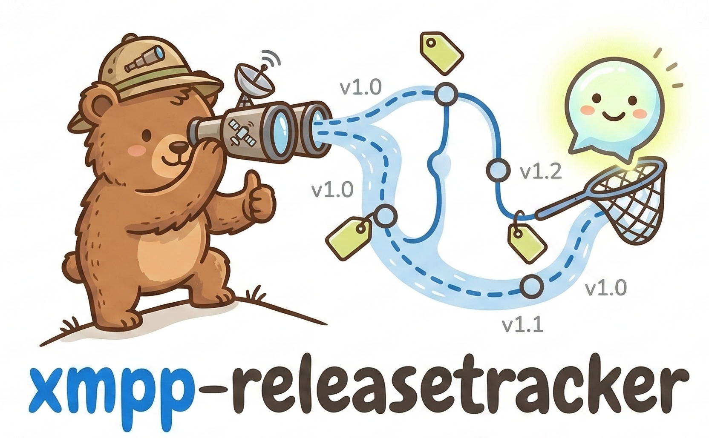

# xmpp-releasetracker



A Go bot that watches repositories on GitHub, GitLab, and Gitea for new releases or tags, and announces them via XMPP and/or Matrix — both to group rooms and to individual users.

## Features

- Monitors **GitHub**, **GitLab** (self-hosted or gitlab.com), and **Gitea** instances
- Tracks individual repos, user starred repos, organizations, and GitLab groups
- Sends notifications to **XMPP MUC rooms**, **Matrix rooms**, and **direct messages** on either protocol
- Persists seen releases in SQLite — no duplicate announcements after a restart
- Silent on first run: snapshots current releases without announcing them
- Optional pre-release filtering per entry or globally
- Pure Go, no CGO required

## Requirements

- Go 1.25+
- An XMPP account and/or a Matrix account for the bot

## Installation

```bash
git clone https://github.com/RoiArthurB/xmpp-releasetracker.git
cd xmpp-releasetracker
go build -o xmpp-releasetracker .
```

## Configuration

Copy the example config and edit it:

```bash
cp config.yml.example config.yml
$EDITOR config.yml
```

### Full reference

At least one of `xmpp` or `matrix` must be configured; you can use either alone, or both at once.

```yaml
xmpp:                           # Optional if matrix is configured
  jid: "bot@example.com"        # Bot's JID
  password: "secret"
  server: "example.com:5222"    # Optional. Defaults to the domain part of the JID on port 5222
  muc_nick: "releasebot"        # Nickname used when joining MUC rooms

matrix:                         # Optional if xmpp is configured
  user_id: "@releasebot:example.org"
  homeserver: "https://matrix.example.org"  # Optional. Discovered from the user ID's
                                            # server via .well-known when omitted
  access_token: "syt_xxx"       # Recommended. Or use password instead (see below)
  # password: "secret"          # Logs in at startup and logs out on shutdown
  # device_id: "RELEASEBOT"     # Optional. Device to reuse on password login

backends:
  github:
    token: "ghp_xxx"            # Optional. With a token, releases are fetched via the REST API
                                # (authoritative pre-release/draft flags); without one, the
                                # unmetered Atom feed is used and pre-releases are guessed
                                # from tag names
  gitlab:
    - url: "https://gitlab.com"
      token: "glpat-xxx"
    - url: "https://gitlab.example.com"   # Self-hosted instance
      token: "glpat-yyy"
  gitea:
    - url: "https://gitea.example.com"
      token: "xxx"

database:
  path: "./releasetracker.db"   # Default: ./releasetracker.db

interval: 3600                  # Seconds between poll cycles. Default: 3600
verbose: false                  # Log warnings for repos without releases (404s). Default: false. Optional
skip_prereleases: false         # Skip pre-releases globally. Default: false. Optional

# Optional. Receives notifications for every tracked repo.
# Per-entry notify lists are additive on top of this.
# Duplicates between the two are ignored automatically.
default_notify:
  - jid: "you@example.com"
    type: direct
  - jid: "general@conference.example.com"
    type: muc
  - id: "#releases:matrix.org"
    type: matrix_room

tracking:
  - ...                         # See "Tracking entries" below
```

### Tracking entries

Each entry in `tracking` describes what to watch and where to send notifications.

All entries accept an optional `skip_prereleases` field that overrides the global setting for that entry:

```yaml
- type: repo
  backend: gitea
  slug: "owner/repo"
  skip_prereleases: true        # only stable releases for this repo
  notify:
    - jid: "room@conference.example.com"
      type: muc
```

> **Backend support:** on **Gitea**, and on **GitHub** when a token is configured, the pre-release flag comes straight from the forge's API and is authoritative. On **GitLab**, and on GitHub without a token (or while rate-limited, when the bot falls back to the Atom feed), pre-releases are detected heuristically from the tag and release name (`-rc1`, `-beta`, `-alpha`, …), so a release marked pre-release on the forge without such a marker will slip through.

#### Single repository

```yaml
- type: repo
  backend: github               # github, gitlab, or gitea
  slug: "owner/repo"
  notify:
    - jid: "room@conference.example.com"
      type: muc
    - jid: "user@example.com"
      type: direct
```

For GitLab and Gitea, add an `instance` field to select which configured instance to use:

```yaml
- type: repo
  backend: gitlab
  slug: "group/project"
  instance: "https://gitlab.example.com"
  notify:
    - jid: "room@conference.example.com"
      type: muc
```

#### User starred repositories

Watches all repositories starred by a given user:

```yaml
- type: user_stars
  backend: github
  username: "someuser"
  notify:
    - jid: "room@conference.example.com"
      type: muc
```

#### Organization repositories (GitHub / Gitea)

Watches all repositories belonging to an organization:

```yaml
- type: org
  backend: github
  org: "golang"
  notify:
    - jid: "room@conference.example.com"
      type: muc
```

#### Group repositories (GitLab)

Watches all projects inside a GitLab group:

```yaml
- type: group
  backend: gitlab
  group: "gitlab-org"
  instance: "https://gitlab.com"
  notify:
    - jid: "room@conference.example.com"
      type: muc
```

### Notification targets

XMPP targets use the `jid` field, Matrix targets the `id` field:

| `type`          | Address field | Example                              | Description                    |
|-----------------|---------------|--------------------------------------|--------------------------------|
| `muc`           | `jid`         | `room@conference.example.com`        | XMPP MUC room                  |
| `direct`        | `jid`         | `user@example.com`                   | XMPP direct (1:1) message      |
| `matrix_room`   | `id`          | `#releases:example.org` or `!roomid` | Matrix room, by alias or ID    |
| `matrix_direct` | `id`          | `@alice:example.org`                 | Matrix direct (1:1) message    |

Both protocols can be mixed in the same `notify` list:

```yaml
notify:
  - jid: "room@conference.example.com"
    type: muc
  - id: "#releases:example.org"
    type: matrix_room
  - id: "@alice:example.org"
    type: matrix_direct
```

### Matrix setup

1. Create a Matrix account for the bot.
2. Get an access token, e.g. by logging in once with any client and copying it (Element: *Settings → Help & About → Access Token*), or via the API:
   ```bash
   curl -s -XPOST https://matrix.example.org/_matrix/client/v3/login \
     -d '{"type":"m.login.password","identifier":{"type":"m.id.user","user":"releasebot"},"password":"secret"}'
   ```
   Alternatively, set `password` and the bot logs in on each start (and logs out on shutdown, so it does not pile up devices).
3. Rooms: the bot joins every `matrix_room` target at startup. Public rooms work as-is; for private rooms, **invite the bot first**. Joining accepts the pending invite.
4. Direct messages: the bot opens a DM room with the user and invites them on the first notification. Accept the invite to see it (earlier messages are kept). The DM is recorded in the bot's `m.direct` account data, so it is reused across restarts.

> **Limitation: no end-to-end encryption.** The bot does not implement E2EE. It can post in encrypted rooms, but its messages are sent unencrypted, and clients mark them as such. DM rooms it creates itself are unencrypted.

## Usage

```bash
./xmpp-releasetracker -config config.yml
```

The `-config` flag defaults to `config.yml` in the current directory.

On its first poll of a repo, the bot records that repo's existing releases without announcing them, so that setting it up doesn't flood your rooms with old releases. For each repo this logs a line like `[github] owner/repo: first discovery, recorded 5 existing release(s) without announcing`. After that, only new releases are announced: those published in the last 7 days, and not prereleases when `skip_prereleases` is set.

To check that every notify target is reachable without waiting for a release, use `-test-notify`. It connects and sends one test message to each distinct target (`default_notify` plus every `notify` list), then exits. It logs each result and exits with status 1 if any target failed:

```bash
./xmpp-releasetracker -config config.yml -test-notify
# with Docker Compose (stop the running service first, so two bot sessions don't run at once):
docker compose stop releasetracker
docker compose run --rm releasetracker -config /etc/xmpp-releasetracker/config.yml -test-notify
docker compose start releasetracker
```

## Docker

### Build and run manually

```bash
docker build -t xmpp-releasetracker .
docker run -d \
  --name releasetracker \
  --restart unless-stopped \
  -v "$(pwd)/config.yml:/etc/xmpp-releasetracker/config.yml:ro" \
  -v releasetracker-data:/data \
  xmpp-releasetracker
```

### Docker Compose

```bash
cp config.yml.example config.yml
$EDITOR config.yml        # fill in your credentials
docker compose up -d
```

To follow the logs:

```bash
docker compose logs -f
```

To rebuild after a code change:

```bash
docker compose up -d --build
```

### Database path in containers

The container exposes `/data` as a volume for persistent storage. Set the database path in your `config.yml` accordingly:

```yaml
database:
  path: "/data/releasetracker.db"
```

The config file itself is mounted read-only at `/etc/xmpp-releasetracker/config.yml` and never written to by the bot.

## Notification format

```
[Github] owner/repo — v1.2.3 "Release name"
https://github.com/owner/repo/releases/tag/v1.2.3

Release notes here, capped at 10 lines / 2000 characters...
```

On XMPP, messages use [XEP-0393 Message Styling](https://xmpp.org/extensions/xep-0393.html) for the bold headline (`*…*`).

On Matrix, messages are sent as `m.notice` events (the convention for bots, so other bots don't react to them), with an HTML version that has a bold headline and a clickable link. The owner avatar is not included on Matrix.

### Inline images (XMPP)

The bot attaches the repository owner's avatar as an inline image using [XEP-0385 Stateless Inline Media Sharing (SIMS)](https://xmpp.org/extensions/xep-0385.html). Support varies by client:

| Client | Image displayed? |
|--------|-----------------|
| MonocleChat (iOS/Android) | ✅ Yes |
| Gajim | ❌ No |
| Movim | ❌ No (sanitizes external `` tags) |

**Note:** XEP-0385 has _Deferred_ status. Contributions to improve client compatibility are welcome!

## How it works

On each poll cycle the tracker:

1. Resolves the list of repos for each tracking entry (direct slug, or expanded from stars/org/group)
2. Fetches the latest releases from the backend API (up to 5 per repo)
3. Checks each release against the `seen_releases` table in SQLite
4. Announces unseen releases published within the last 7 days, in chronological order
5. Records every release as seen so it is never announced again

**First run / new repo:** all currently known releases are recorded silently without announcement. This prevents flooding when a repo is first added to the config.

## Project structure

```
main.go
config.yml.example
Dockerfile
compose.yml
internal/
  config/       # YAML loading and validation
  store/        # SQLite persistence (seen releases)
  backend/
    backend.go  # Backend interface and Release type
    github/     # GitHub Atom feed
    gitlab/     # GitLab REST API
    gitea/      # Gitea REST API
  tracker/      # Polling loop and notification logic
  xmpp/         # XMPP connection, MUC join, message sending
  matrix/       # Matrix Client-Server API: room join, DMs, message sending
```

## License

MIT
